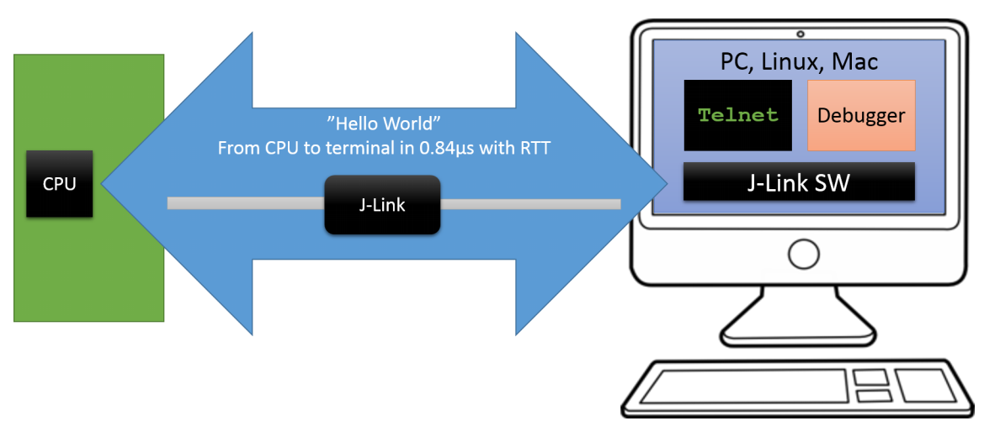
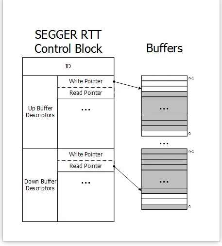
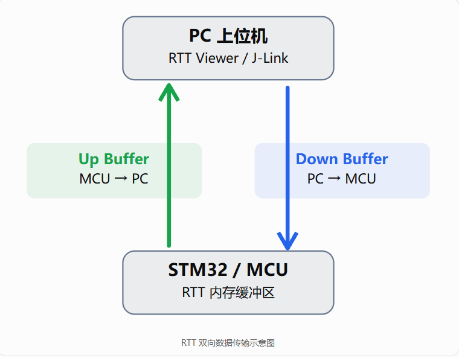
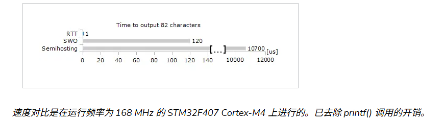
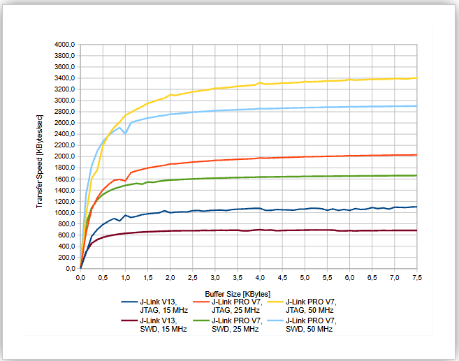
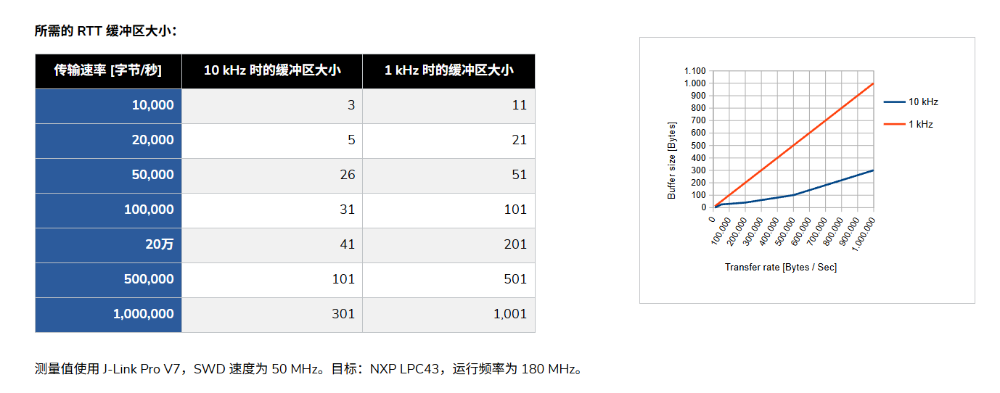
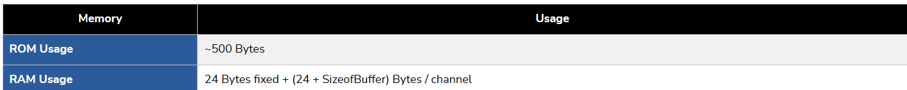

> 目标：
>
> - 理解 J-Link RTT 如何绕过 UART 外设，通过 SWD/JTAG 访问目标 RAM 中的环形缓冲区。
> - 学会配置 Up Buffer、Down Buffer、虚拟终端和 Flags。
> - 根据实时性、吞吐量和 RAM 预算，在 UART、SWO 与 RTT 之间做出合适的选择。

# 嵌入式芯片调试神器-J-Link RTT

## 一、关于RTT的背景说明？

一些老嵌入式朋友可能会有疑问，欸？啥是`RTT`，为什么要用`RTT`呢，我用`printf`不好吗。当初我学习`C语言`和入门嵌入式时就是使用的`printf`,我已经用的很熟练了，凭什么听你的，叫我说换就换，不行，你必须说服我才可以，不然，嘿嘿，想到别想，笔者的朋友以及笔者自己原来都是这样想的（对尝试新事物感到害怕），那么这篇文章的作用就是去说服像笔者一样固执的老嵌入式成员和开阔新成员眼界了哈哈。

在嵌入式开发中，相信很多人都不想天天一步步`debug`或者是天天盯着寄存器企图看穿未来吧（真的可以望眼欲穿吗），想起这个来就感觉到前路充满了"光明"（我们都在努力的活着~）,那么怎么逃离苦难呢，哈哈此时日志打印就发挥作用了，只需看看日志就好了，一些简单的情况都不用`debug`，“真爽（嵌入式最爽的时候"，后面将慢慢介绍笔者的断言`assert`配合`__FILE__和 __LINE__这两个C预定义宏，`方便你直接定位错误发生在哪一个文件哪一行（俗称小军用刀，指哪里跳哪里）。此时如果采用`printf`确实可以实现日志打印的功能，但是太费时间了，问题就在于`UART/DMA`的`98%`时间花在串行移位发送(例如:115200bps物理限制）,格式化`format`只占用了一小部分时间，`RTT`反过来了，时间全花在式化`format`,传输仅2μs（一次内存拷贝的时间差不多），而且`RTT`不会占用外设资源和引入中断问题。这么说的话，还不赶快抛弃`printf`,加入`RTT`大家庭（笔者真不是一个喜新厌旧的人，没办法`RTT`给的太好了哈哈）
当你接收了一个项目对时序要求极其苛刻的项目时，项目对时序要求极其苛刻，传统串口打印就像在高速公路上设置了一个收费站：每输出一个字符，都要经过 UART 外设逐 bit 发送，等待发送完成，日志一多，任务和中断的节拍就会被拖慢。RTT 则像给调试打开了“上帝视角”——只要开发板通过 SWD 或 JTAG 连接着 J-Link（或其他支持 RTT 的调试探针），就能在 PC 端实时查看日志、输出变量，甚至向目标板发送命令，而且不需要额外占用 UART 引脚。

RTT 的关键思路是：目标程序把数据写入 RAM 中的环形缓冲区，调试器在后台读取这些内存，再交给 RTT Viewer 或其他客户端显示。数据传输的瓶颈从串口的逐 bit 移位，转变为内存写入和调试器读取，因此对目标程序时序的影响通常远小于传统 UART `printf`。这里的“实时”仍然有边界：格式化、内存拷贝、锁和缓冲区管理都会产生少量开销，缓冲区满时还可能丢弃数据或阻塞写入。

RTT 特别适合以下场景：

- 使用 ARM Cortex-M、Cortex-R、Cortex-A、RISC-V 等主流内核，并且手头有 J-Link 调试器。
- 排查复杂的时序问题，观察高频系统状态，或记录性能分析事件。
- 希望获得比 UART 更干净、更高效的日志输出方式，同时保留从 PC 向目标板发送命令的能力。

花半小时掌握 RTT 的控制块、缓冲区和常用 API，往往就能把调试体验提升一个台阶。

---

## 二、准备工作

开始之前，准备以下硬件和软件：

- 支持 SWD 或 JTAG 的目标开发板，以及对应的 ARM Cortex-M/R/A、RISC-V 等处理器。
- J-Link 调试器和稳定的 USB 连接；如果使用其他探针，需要确认它支持 RTT 或后台内存访问。
- J-Link 调试器的驱动[J-Link](https://www.segger.com/downloads/jlink/)
- SEGGER J-Link RTT Viewer，或能读取 RTT 通道的其他主机客户端。
- 目标工程[SEGGER](https://github.com/SEGGERMicro/RTT.git)中的 `SEGGER_RTT.c`、`SEGGER_RTT.h` 和（需要格式化输出时）`SEGGER_RTT_printf.c`。
- 可选的 OpenOCD 或其他调试服务器。不同版本对 RTT 的发现和读取方式可能不同，本文的函数签名与细节以指定 SEGGER RTT 源码为准。

> RTT 不会凭空建立通信链路。调试器必须能够连接目标芯片、访问目标 RAM，并在目标程序运行时找到 RTT 控制块。

---

## 三、RTT 是什么

### 3.1 RTT（Real Time Transfer）简介

SEGGER RTT（Real Time Transfer）是一种用于嵌入式应用交互式用户 I/O 的技术。它结合了 SWO 的高效率和半主机的易用性，支持目标到主机、主机到目标的双向通信，也支持多个独立通道和多个虚拟终端。

RTT 可以与支持后台内存访问的 J-Link 以及目标处理器配合使用。常见用途包括日志输出、变量观察、性能数据采集、命令行交互和故障现场记录。



### 3.2 调试器与目标板的“握手”过程

RTT 的通信是异步的，目标程序不需要等待调试器完成一次完整的传输：

1. **目标板端**：应用调用 `SEGGER_RTT_printf(0, "Hello RTT!\n")`。函数不操作 UART，而是把字符串写入 RAM 中上行通道 0 的环形缓冲区，并更新写指针。
2. **调试器端**：PC 上的 RTT Viewer 通过 J-Link 访问目标 RAM，周期性检查 RTT 控制块。当上行通道 0 的读指针和写指针不相等时，调试器就知道有新数据。
3. **数据抓取**：J-Link 通过 SWD/JTAG 读取新增字节，主机客户端再将它们显示在 PC 界面中。
4. **下行方向**：你在 RTT Viewer 中输入的字符会写入下行缓冲区，目标程序通过 `SEGGER_RTT_GetKey()` 或 `SEGGER_RTT_Read()` 取出。

整个过程绕过了芯片的 UART 外设，也不要求 UART 中断服务程序搬运数据，因此通信开销通常很小。RTT 仍会占用目标板 RAM：缓冲区大小在编译前通过宏定义配置，例如默认的 `BUFFER_SIZE_UP` 是 1024 字节。如果芯片只有几 KB RAM，应根据日志量谨慎设置缓冲区。

### 3.3 RTT 的内部结构

RTT 控制块位于目标 RAM 中，包含上行和下行缓冲区的描述符。J-Link 通过扫描已知的 ID 字符串定位控制块，再根据每个缓冲区的读写指针判断数据是否为空或已满。



- **SEGGER_RTT 控制块**：保存缓冲区地址、大小、读写位置和 Flags。
- **上行通道（Up Buffer）**：目标固件写入，J-Link/主机读取，方向是 MCU → PC。
- **下行通道（Down Buffer）**：主机写入，目标固件读取，方向是 PC → MCU。

当读指针和写指针相等时，环形缓冲区为空。实现通常保留一个字节来区分“空”和“满”，因此容量为 `N` 的缓冲区最多保存 `N - 1` 字节。

> RTT 不需要额外的串口芯片、GPIO 引脚或专用中断；但目标程序仍需把 RTT 源码编译进工程，并为控制块和缓冲区预留 RAM。

---

## 四、基础概念

### 4.1 RTT 的上行和下行

RTT 是 SEGGER 提供的一种基于调试接口（SWD/JTAG）的数据通信机制。

它不需要专门占用 MCU 的 UART、USB 等通信外设，而是利用 MCU 内存中的 RTT 控制块和缓冲区进行通信。J-Link 通过调试接口访问这些内存，PC 软件再显示日志或发送输入。



RTT 有两种方向：

| 类型                      | 数据方向 | 主要用途                       | MCU 常用 API                           |
| ------------------------- | -------- | ------------------------------ | -------------------------------------- |
| Up Buffer（上行缓冲区）   | MCU → PC | 输出日志、调试信息、二进制数据 | `Write()`、`WriteString()`、`printf()` |
| Down Buffer（下行缓冲区） | PC → MCU | 接收上位机命令、参数           | `Read()`、`GetKey()`                   |

例如 STM32 执行：

```c
SEGGER_RTT_printf(0, "Hello STM32!\n");
```

这是上行数据。RTT Viewer 输入 `LED_ON` 后，STM32 通过 `SEGGER_RTT_Read()` 取出它，就是下行数据。

> 下文所说的“写入成功”，通常指数据已经放进 MCU 的 RTT 上行缓冲区，不表示 PC 已经读取或显示完毕（这个要看你用的上位机了）。

### 4.2 通道索引与虚拟终端

`BufferIndex` 表示缓冲区通道索引，从 `0` 开始。上行和下行分别有自己的索引空间。

- `SEGGER_RTT_Write(0, ...)`：写上行通道 0。
- `SEGGER_RTT_Read(0, ...)`：读下行通道 0。
- 两个 `0` 表示相同的索引编号，但对应两块不同的缓冲区。

`TerminalId` 表示虚拟终端编号。多个虚拟终端共享**上行通道 0**，通过数据流中的控制命令切换显示位置。

> `SEGGER_RTT_SetTerminal(1)` 是选择虚拟终端 1；`SEGGER_RTT_Write(1, ...)` 是写上行通道 1。二者不能混用。官方工具通常使用通道 0；新增通道后还需要支持该通道的主机程序。

### 4.3 RTT 的双向多通道

RTT 的通道按方向分别编号：上行通道用于 **MCU → 主机**，下行通道用于 **主机 → MCU**。同一个编号在两个方向各自代表一块缓冲区，例如 `SEGGER_RTT_Write(1, ...)` 写的是上行通道 1，而 `SEGGER_RTT_Read(1, ...)` 读的是下行通道 1；它们不是同一个通道，也不共享数据。

>注意:发送和接收是两个缓冲区，大小可以自己视情况改变

默认实现每个方向只建立通道 0，通常用于可打印的终端输入和输出。其他通道可以按用途拆分数据：

- 上行通道 0：普通日志、错误信息和调试输出；也可以配合虚拟终端分到多个 RTT Viewer 窗口。
- 额外上行通道：分析数据、事件追踪、性能采样或其他二进制数据，避免与文本日志混在同一字节流中。
- 下行通道 0：命令行输入、参数和控制命令。
- 额外下行通道：配置、控制协议或独立的主机到目标数据流。

通道槽位数量由 `SEGGER_RTT_MAX_NUM_UP_BUFFERS` 和 `SEGGER_RTT_MAX_NUM_DOWN_BUFFERS` 决定，但有槽位不等于已经完成配置。通道 0 的名称、缓冲区地址、大小和默认 Flags 在编译配置中确定；在本地实现中，调用 `SEGGER_RTT_Init()` 或任何会触发内部初始化的 RTT 写入函数后立即建立。对通道 0 调用 `SEGGER_RTT_ConfigUpBuffer()` / `SEGGER_RTT_ConfigDownBuffer()` 时，只有 Flags 可以手动重新配置，传入的名称、地址和大小不会替换编译时的默认值。

通道 1 及以上必须由应用在初始化阶段分别调用 `SEGGER_RTT_ConfigUpBuffer()` 或 `SEGGER_RTT_ConfigDownBuffer()`，提供长期有效的名称和环形缓冲区。之后还要使用对应的 `Write()` / `Read()` 索引收发数据；配置函数本身不会自动发送、接收或解析数据。

[J-Link RTT Viewer](https://kb.segger.com/J-Link_RTT_Viewer) 的虚拟终端功能针对**上行通道 0**：它能在同一上行缓冲区中按终端控制命令显示多个“虚拟”终端。上行通道 1、2 等是真正独立的 RTT 通道，不能因为配置了它们就自动在 RTT Viewer 中出现额外窗口；需要主机工具支持选择并读取对应通道。

### 4.4 RTT_CTRL_TEXT_* 颜色控制宏

这些宏不是 RTT 专用的数据格式，而是主机终端能够识别的 ANSI/VT100 控制序列。宏中的 `\x1B` 会由 C 编译器转换为 ESC（十六进制 `0x1B`）；后面的 `[2;30m` 等参数会请求终端使用指定的前景色。其中 `2` 表示较暗（dim/faint）样式，`30`～`37` 表示黑、红、绿、黄、蓝、品红、青、白。

```c
#define RTT_CTRL_TEXT_BLACK   "\x1B[2;30m"
#define RTT_CTRL_TEXT_RED     "\x1B[2;31m"
#define RTT_CTRL_TEXT_GREEN   "\x1B[2;32m"
#define RTT_CTRL_TEXT_YELLOW  "\x1B[2;33m"
#define RTT_CTRL_TEXT_BLUE    "\x1B[2;34m"
#define RTT_CTRL_TEXT_MAGENTA "\x1B[2;35m"
#define RTT_CTRL_TEXT_CYAN    "\x1B[2;36m"
#define RTT_CTRL_TEXT_WHITE   "\x1B[2;37m"
#define RTT_CTRL_RESET        "\x1B[0m"
```

用法是把颜色宏放在文本前面，并在文本后发送 `RTT_CTRL_RESET` 恢复默认样式。C 语言会自动拼接相邻字符串字面量，因此既可用于 `WriteString()`，也可作为 `printf()` 的格式字符串：

```c
SEGGER_RTT_WriteString(0,
    RTT_CTRL_TEXT_RED "ERROR: motor timeout" RTT_CTRL_RESET "\n");

SEGGER_RTT_printf(0,
    RTT_CTRL_TEXT_GREEN "speed=%d" RTT_CTRL_RESET "\n", speed);
```

颜色控制字节会占用 RTT 上行缓冲区空间，但不会改变正文长度。颜色只在主机端解释 ANSI/VT100 控制序列时生效；若使用原始数据采集工具或不支持颜色的查看器，可能直接看到这些转义字节。颜色作用于当前活动的虚拟终端，切换终端时应在需要的位置重新发送颜色，并在日志结束时恢复样式。`RTT_CTRL_RESET` 若已由工程头文件提供，应直接复用，避免重复定义。

### 4.5 当前工程的默认配置

配置读取顺序为：`SEGGER_RTT.h` → `SEGGER_RTT_ConfDefaults.h` → `SEGGER_RTT_Conf.h`。指定工程的 `SEGGER/Config/SEGGER_RTT_Conf.h` 目前没有覆盖配置，因此默认值如下；编译命令中的宏定义仍可能覆盖它们。

| 配置宏                            | 默认值                          | 含义                                |
| --------------------------------- | ------------------------------- | ----------------------------------- |
| `SEGGER_RTT_MAX_NUM_UP_BUFFERS`   | `3`                             | 最多 3 个上行通道槽位，索引 0、1、2 |
| `SEGGER_RTT_MAX_NUM_DOWN_BUFFERS` | `3`                             | 最多 3 个下行通道槽位，索引 0、1、2 |
| `BUFFER_SIZE_UP`                  | `1024`                          | 默认上行通道 0 的内存大小（字节）   |
| `BUFFER_SIZE_DOWN`                | `16`                            | 默认下行通道 0 的内存大小（字节）   |
| `SEGGER_RTT_MODE_DEFAULT`         | `SEGGER_RTT_MODE_NO_BLOCK_SKIP` | 通道 0 的默认模式                   |
| `SEGGER_RTT_PRINTF_BUFFER_SIZE`   | `64u`                           | 格式化输出的临时缓冲区大小          |

`SEGGER_RTT_ConfDefaults.h` 中与默认缓冲区大小相关的定义如下：

```c
#ifndef BUFFER_SIZE_UP
#define BUFFER_SIZE_UP   (1024)
#endif

#ifndef BUFFER_SIZE_DOWN
#define BUFFER_SIZE_DOWN (16)
#endif
```

如果工程需要调整大小，应在自己的 `SEGGER_RTT_Conf.h` 中覆盖这些宏，不直接修改默认配置文件。

> 有 3 个通道槽位不代表 3 个通道都已配置。初始化时只建立上行 0 和下行 0，索引 1、2 需要另外配置。需要调整参数时，在 `SEGGER_RTT_Conf.h` 中覆盖宏，不直接修改 `SEGGER_RTT_ConfDefaults.h`。

### 4.6 三种 Flags 模式的区别

下面的模式决定**写入方在缓冲区空间不足时怎么办**。

| 完整宏名称                           | 值  | 空间不足时的行为                               |
| ------------------------------------ | --- | ---------------------------------------------- |
| `SEGGER_RTT_MODE_NO_BLOCK_SKIP`      | `0` | 非阻塞；无法容纳本次完整写入时，本次不写入     |
| `SEGGER_RTT_MODE_NO_BLOCK_TRIM`      | `1` | 非阻塞；写入能容纳的部分，剩余部分舍弃         |
| `SEGGER_RTT_MODE_BLOCK_IF_FIFO_FULL` | `2` | 阻塞；等待主机取走数据、腾出空间，直到本次写完 |

例如写 20 字节但只剩 8 字节空间：SKIP 写入 0 字节，TRIM 写入 8 字节，BLOCK 等待后写入 20 字节。对 Down Buffer，PC 是通常的写入方，具体行为取决于主机端实现；配置成 BLOCK 不会让 MCU 的 `SEGGER_RTT_Read()` 自动等待。

>笔者建议统一采用`SEGGER_RTT_MODE_NO_BLOCK_SKIP`,又不会出现打印一半，又不影响程序运行，多好

---

## 五、性能、吞吐量与内存占用

### 5.1 RTT 性能

RTT 的一次短文本输出通常只需要完成格式化和一次内存写入，目标端耗时可以接近 `memcpy()` 的量级。实际表现仍取决于 J-Link 型号、调试接口速度、主机轮询频率、缓冲区大小和写入模式。



### 5.2 传输速度

输出数据的最大速度由目标缓冲区能否持续吸收数据，以及 J-Link 和调试接口的读取速度共同决定。官方示例显示，即使目标缓冲区只有 512 字节，较高的接口速度也可能达到约 2 MB/s；普通 J-Link 型号的典型速度会低一些。不要把宣传中的峰值当作所有板卡都能稳定达到的吞吐量，应以自己的目标板和日志负载实测。



### 5.3 目标缓冲区大小

缓冲区至少要能容纳一次突发写入；如果日志在 1 ms 内持续产生，还应覆盖这段时间的峰值数据量。缓冲区越大，越不容易因为 J-Link 暂时没有及时读取而丢日志，但会占用更多 RAM。



### 5.4 内存占用

RTT 实现本身通常只占用少量 ROM；控制块和每个通道的描述符会占用 RAM，真正占空间的是各通道环形缓冲区。常见起点是上行 1 KB、下行 16～32 字节，再根据日志峰值和丢包情况调整。



### 5.5 性能取舍

- **更大的缓冲区**可以减少因主机读取不及时导致的丢包，但会消耗目标 RAM。
- **SKIP 模式**不等待，时序更可预测，但空间不足时可能整条丢弃。
- **TRIM 模式**尽可能写入当前可用空间，但一条日志可能被截断。
- **BLOCK 模式**尽力保证数据完整，但空间不足时会等待，可能影响实时任务。
- 多任务同时输出时，应在应用层串行化整条日志，避免不同任务的文本交错。

## 六、后续开发计划

- 进行`RTT`的`API` 函数讲解(讲清楚怎么使用)
- `RTT Viewer`使用以及笔者在朋友帮助下完成的`RTT`二次封装`bsp_log`代码的使用（包括断言和军用小刀的使用）
- `J-Scope`的`HSS`,`RTT`,`RTT PLUS`的使用和讲解
